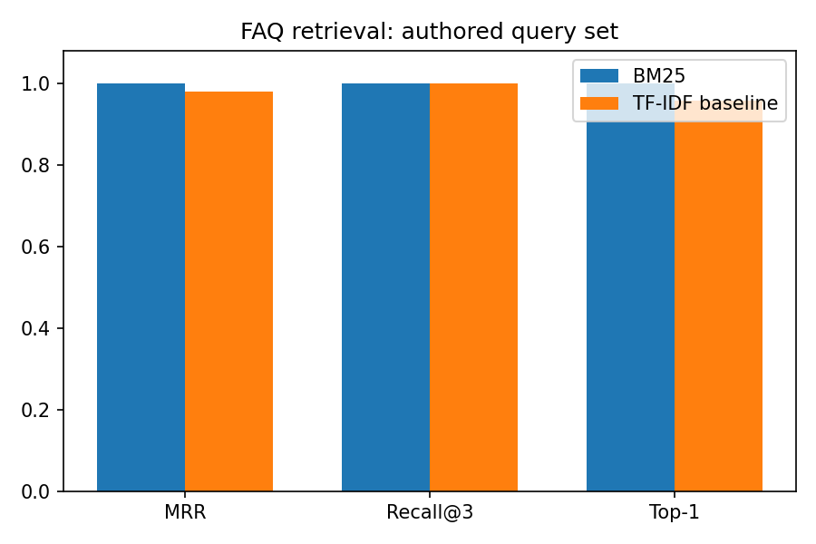

# 本次运行结果

由 `main.py` 实际运行后生成。重新运行可能随依赖版本略有变化。
教学或模拟数据指标不代表真实业务效果。

```json
{
  "bm25": {
    "mrr": 1.0,
    "recall_at_3": 1.0,
    "top1_accuracy": 1.0
  },
  "tfidf_baseline": {
    "mrr": 0.9791666666666666,
    "recall_at_3": 1.0,
    "top1_accuracy": 0.9583333333333334
  }
}
```



完整输出：[`outputs/metrics.json`](outputs/metrics.json)。
